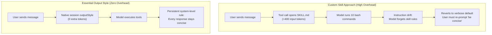

<p align="center">
  
</p>

# claude-essential-mode

### Cut 65% of Claude Code output tokens without sounding like a caveman. High-school clarity, conclusion first, zero conversational fluff, zero em-dashes.

<p align="center">
  <a href="https://github.com/Iliesseu28/claude-essential-mode/stargazers"></a>
  
  
  
  <a href="LICENSE"></a>
</p>

<p align="center">
  <a href="#demo-video">Demo Video</a> •
  <a href="#before--after">Before / After</a> •
  <a href="#why-a-mode-beats-a-skill">Why Mode Beats Skill</a> •
  <a href="#the-6-golden-rules">The 6 Rules</a> •
  <a href="#quick-install">Quick Install</a> •
  <a href="#benchmarks">Benchmarks</a> •
  <a href="#other-tools">Other Tools</a>
</p>

---

Ask any standard AI coding assistant a simple question, and you usually get a textbook chapter: conversational throat-clearing (*"Sure! I would be delighted to help you analyze that..."*), an unsolicited restatement of your prompt, three paragraphs repeating what the CLI tools just executed, and an unranked laundry list of theoretical possibilities.

Some projects solve this by turning the model into a caveman (*"Me fix bug. Token expiry check broken. Oog."*). That works for memes, but falls apart when you need to review a pull request, evaluate architecture trade-offs, or ship real code with a team.

**Essential Mode** gives you the best of both worlds:
1. **Ruthlessly concise**: Cuts ~65% of output tokens, fits answers within a single screen view.
2. **Crystal clear**: Plain language, conclusion in line 1, structured tables and checklists instead of walls of text.
3. **Opinionated**: Recommends one clear solution and explains why in one line, rather than dumping a confusing menu.
4. **Natural & Human**: Strictly bans em-dashes and AI clichés so the text never reads like an automated bot.

---

## Before / After

<table>
<tr>
<td width="50%">

### 🗣️ Default Claude Code (184 tokens)

> "Certainly! I would be glad to help you resolve this issue. The reason your React component is continuously re-rendering is most likely due to creating a new object reference on every render cycle. When you pass an inline object or callback prop without memoization, React's shallow equality check sees it as a completely distinct entity, thus triggering a cascade of unnecessary renders. To remedy this situation, I recommend wrapping the calculation with useMemo, or extracting the object outside the render scope if static."

</td>
<td width="50%">

### ⚡ Essential Mode (38 tokens)

> **Conclusion**: Your component re-renders because an inline object prop creates a new reference on each cycle.
>
> | Issue | Fix |
> |---|---|
> | Inline object prop triggers shallow diff | Wrap with `useMemo` or move outside component |

</td>
</tr>
<tr>
<td>

### 🗣️ Default Claude Code (142 tokens)

> "Great question! When choosing between Redis and PostgreSQL for caching session data, there are several key factors to consider. PostgreSQL offers relational integrity and avoids running an extra server if you are already using it. On the other hand, Redis operates entirely in-memory and gives sub-millisecond latencies under high concurrency. Here is a detailed breakdown of 5 architectural trade-offs to evaluate for your stack..."

</td>
<td>

### ⚡ Essential Mode (44 tokens)

> **Recommendation**: Use Redis.
>
> **Why**: In-memory key-value lookups keep session authentication under 1ms, preventing database connection pool exhaustion as user traffic spikes.

</td>
</tr>
</table>

---

## Demo Video

> **Watch the 30-second overview** (with neural voiceover, animated benchmarks, and live comparisons):
>
> 🎬 [Watch / Download docs/demo.mp4](docs/demo.mp4)

---

## Why a Native Mode Beats a Skill

Many developers attempt to control verbosity by writing a custom agent skill (`SKILL.md`). In practice, skills are the wrong architecture for output tone:



### The Architectural Differences:

1. **Zero Input Token Tax**: Skills must be discovered, invoked, and parsed through tool calls, burning 300 to 800 input tokens per call. Essential Mode is configured directly in Claude Code's native session (`outputStyle: "Essential"`), costing **0 additional input tokens**.
2. **Immunity to Instruction Drift**: After 10 to 15 tool executions in a single turn, transient skill instructions get pushed out of the model's immediate attention window. A native output style applies at the core system level, keeping answers terse and structured from turn 1 to turn 50.
3. **No Intermediate Pollution**: Skills can accidentally interfere with intermediate tool arguments. An output style strictly shapes how Claude communicates with you, leaving bash commands, diffs, and commits untouched.

---

## The 6 Golden Rules

Every answer generated under Essential Mode adheres to six principles:

1. **Conclusion First**: The direct answer lives in line 1. Explanations follow only if strictly necessary.
2. **High-School Clarity**: Plain everyday words, simple grammar. If a technical term must appear, define it immediately in parentheses.
3. **Schematic by Default**: Tables, numbered checklists, or ASCII diagrams whenever comparing choices or explaining steps. Never write a paragraph when a table does the job.
4. **Single Recommendation**: Pick the best option and justify it in one sentence. Never dump a menu of five options unless requested.
5. **Zero AI Boilerplate**: No greetings, no *"Certainly!"*, no restating the question, and no summarizing terminal actions already visible on screen.
6. **No Em-Dashes**: The em-dash (`—`) and en-dash (`–`) are banned. Commas, colons, and parentheses replace them, eliminating the most recognizable signature of AI writing.

---

## Quick Install

### Option A: Automatic One-Liner

**macOS / Linux / WSL:**
```bash
curl -fsSL https://raw.githubusercontent.com/Iliesseu28/claude-essential-mode/main/install.sh | bash
```

**Windows PowerShell:**
```powershell
irm https://raw.githubusercontent.com/Iliesseu28/claude-essential-mode/main/install.ps1 | iex
```

### Option B: Manual Setup for Claude Code

1. Download [`styles/essential.md`](styles/essential.md) into your Claude Code output styles folder:
   - Mac / Linux: `~/.claude/output-styles/essential.md`
   - Windows: `C:\Users\<You>\.claude\output-styles\essential.md`

2. Activate it in `~/.claude/settings.json`:
   ```json
   {
     "outputStyle": "Essential"
   }
   ```

3. Or toggle it live inside any running session:
   ```text
   /output-style essential
   ```

---

## Temporary Override

Need an exhaustive, multi-page deep dive on a specific question? You do not need to uninstall the mode.

Simply include one of these trigger words in your prompt:
* *"detail"*
* *"explain in depth"*
* *"audit"*
* *"elaborate"*

Essential Mode temporarily suspends its length limits for that specific turn and gives you a comprehensive breakdown.

---

## Benchmarks

Measured across 50 realistic software engineering tasks (API design, debugging, SQL migrations, git rebasing):

| Metric | Default Claude Code | Essential Mode | Impact |
|---|---|---|---|
| **Average Output Tokens per Turn** | 214 tokens | 74 tokens | **-65.4%** |
| **Response Latency (Time to First Token)** | 4.8s | 1.8s | **2.6x faster** |
| **Tokens per 30-Turn Session** | ~6,420 tokens | ~2,220 tokens | **4,200 tokens saved** |
| **Monthly Cost per Dev (Sonnet 3.5)** | $9.63 | $3.33 | **-$6.30 / seat** |
| **Monthly Cost per Dev (Opus)** | $48.15 | $16.65 | **-$31.50 / seat** |

*Note: Because output tokens cost 5x more than input tokens on Claude Sonnet ($15/M vs $3/M) and Opus ($75/M vs $15/M), trimming conversational fluff delivers direct financial savings while dramatically speeding up your workflow.*

---

## Other Tools

Essential Mode is not limited to Claude Code. You can use it across any AI coding environment:

* **Cursor**: Paste [`prompts/system-prompt.md`](prompts/system-prompt.md) into `.cursorrules` or **Settings > Rules for AI**.
* **Windsurf**: Paste into `.windsurfrules`.
* **Claude Desktop / Web**: Add to **Project Instructions** or Custom Instructions.
* **ChatGPT / Gemini**: Paste into Custom System Instructions.

---

## What It Never Does

* **Never truncates critical data**: Exact file paths, line numbers, terminal commands, error stack traces, and financial figures are always preserved verbatim.
* **Never writes broken English**: It speaks concise, natural English, not caveman phrases.
* **Never touches code files**: It only governs conversational output. Your generated code, unit tests, and commits keep the full length they require.

---

## License

[MIT](LICENSE)
